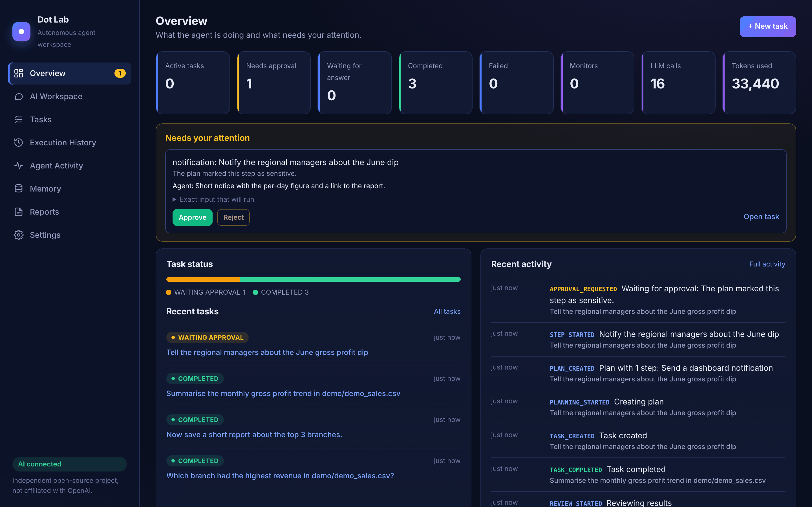
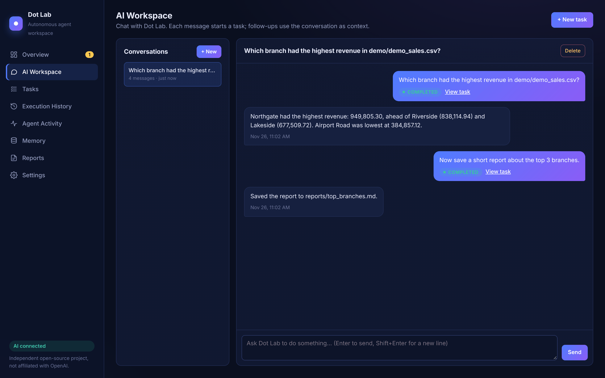
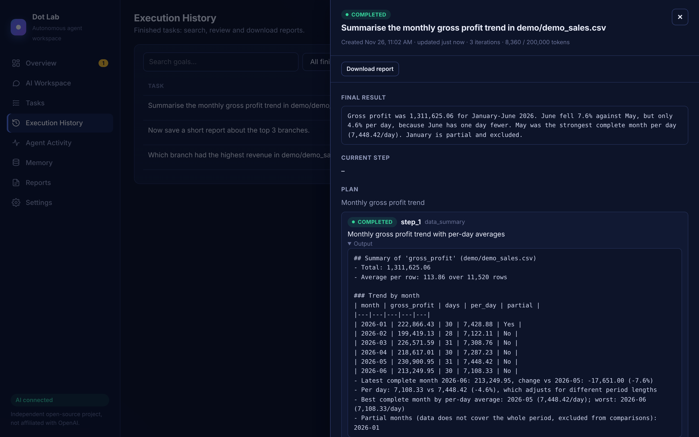
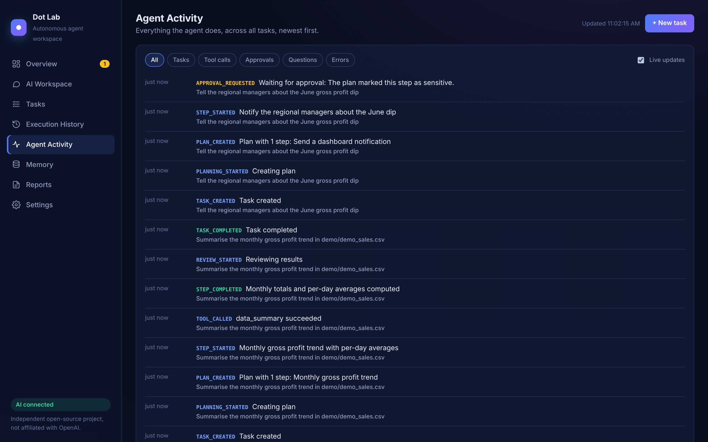
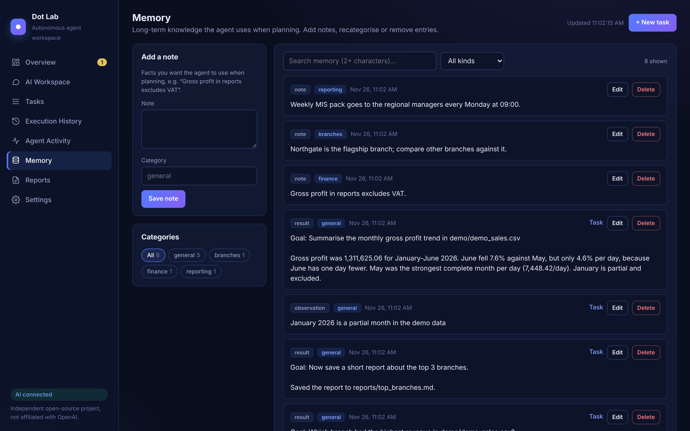
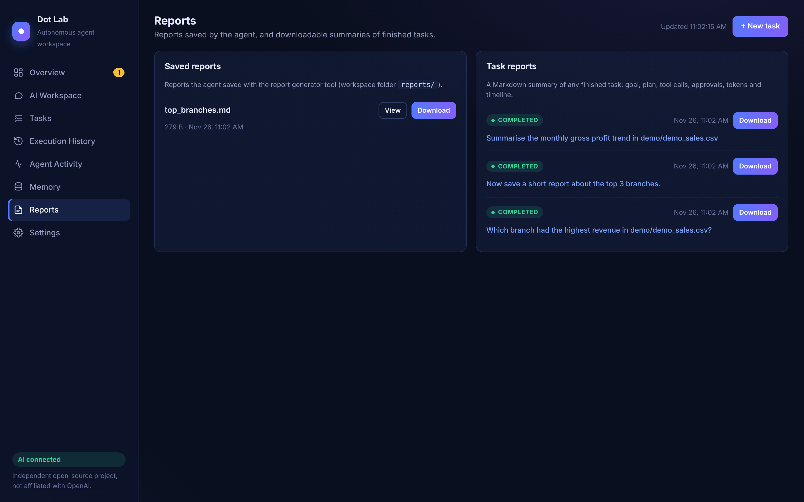
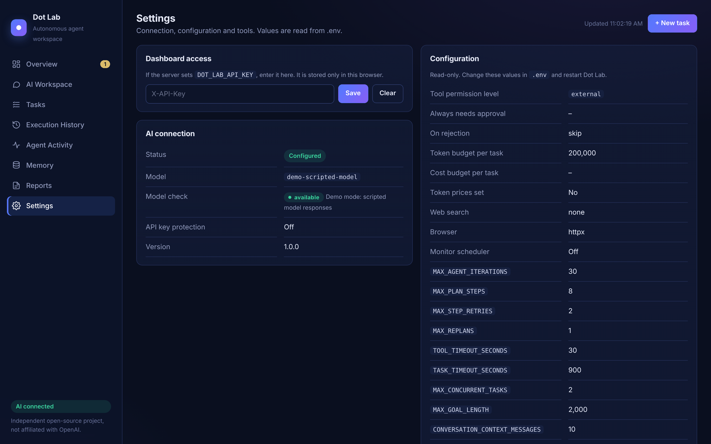
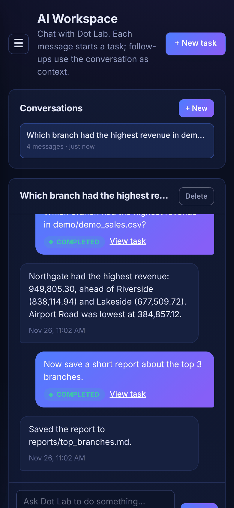
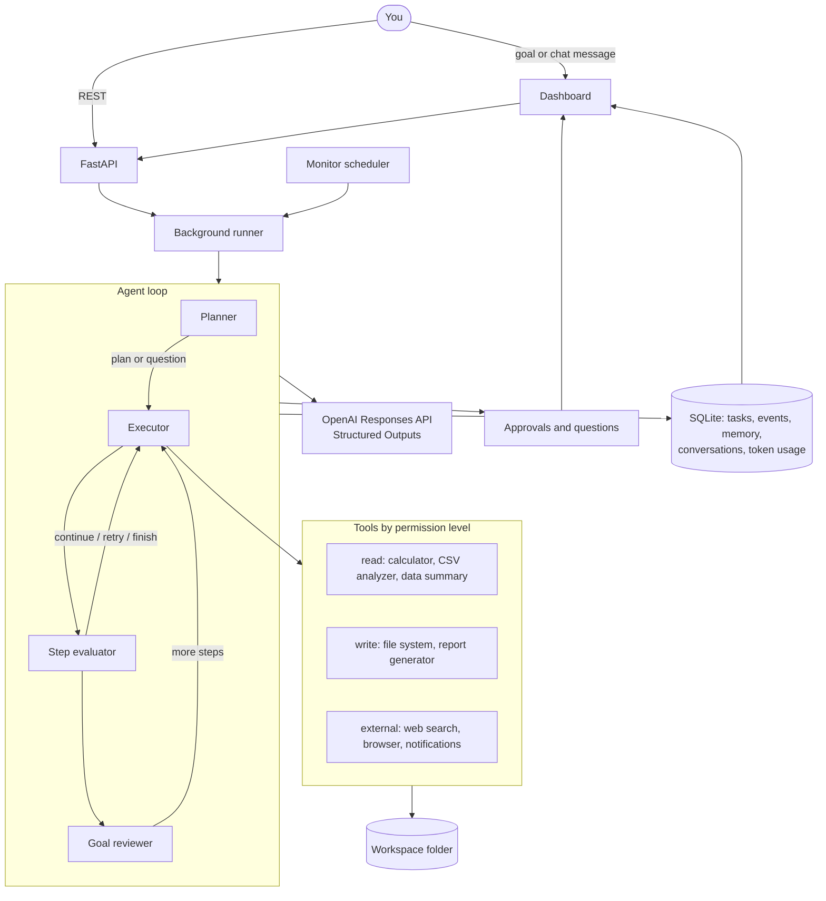

# Dot Lab

[](https://github.com/Anjub004/dot-lab/actions/workflows/ci.yml)
[](https://github.com/Anjub004/dot-lab/releases)
[](pyproject.toml)
[](LICENSE)
[](https://www.kaggle.com/code/anju004/dot-lab-always-on-ai-agent-walkthrough)

An experimental always-on AI agent that plans, uses tools, maintains memory, executes multi-step tasks, and asks for human approval when needed.

> **This project is not affiliated with, endorsed by, or an implementation of OpenAI Dots.**
> Dot Lab is an independent experimental project inspired by the general concept of autonomous, always-on AI agents.



## What is Dot Lab?

Instead of sending one prompt and returning one answer, you give Dot Lab a **goal**. It writes a plan, runs each step with a tool, checks the results, asks you when it needs a decision, and reviews whether the goal was really achieved. Everything it does is recorded and visible in a dashboard.

It is a small, readable codebase for learning how agents work: plain Python with FastAPI and the OpenAI API, **no agent framework**, and every simplification documented.

<table>
  <tr>
    <td width="50%"></td>
    <td width="50%"></td>
  </tr>
  <tr>
    <td align="center"><b>AI Workspace</b>: chat, follow-ups use earlier messages</td>
    <td align="center"><b>Task detail</b>: result, plan, tool output, history</td>
  </tr>
</table>

The screenshots come from the real application running on the bundled demo sales data: the tools really ran and every number is computed by them. Only the model's wording is scripted, so the images can be regenerated without an API key ([`scripts/make_screenshots.py`](scripts/make_screenshots.py)).

## Features

- **Plan → act → review loop** with structured outputs, iteration and time limits, bounded retries and re-planning. A task only counts as completed when the reviewer confirms the goal is met; otherwise the partial result is kept and the task is marked failed.
- **Tools** with permission levels (`read` / `write` / `external`): calculator, web search, read-only browser, sandboxed file system, notifications, and **data analysis** on CSV files (profiles, aggregations, monthly trends with partial periods flagged, rankings, Markdown reports).
- **Human in the loop**: approvals before sensitive actions (the exact approved input is executed), and **clarification questions** instead of guesses.
- **Memory**: long-term memory with categories and your own notes, plus conversations for short-term context.
- **Budgets**: token and optional cost limits per task, with usage shown for every task.
- **Always on**: background execution, pause / resume / cancel, recovery after restart, and an experimental **monitoring mode** that notifies you only when something meaningful changed.
- **Dashboard** (dark, responsive, no build step) with Overview, AI Workspace, Tasks, Execution History, Agent Activity, Memory, Reports and Settings.
- **Engineering**: Alembic migrations, JSON logs with secret redaction, optional API key, offline test suite, live tests, browser smoke test, Docker.

<details>
<summary><b>More screenshots</b></summary>

| | |
|---|---|
|  |  |
| **Agent Activity**: every event across tasks | **Memory**: notes, categories, search, edit |
|  |  |
| **Reports**: saved reports and task reports | **Settings**: connection, configuration, tools |

<p align="center"></p>

</details>

## Quick start

Requirements: Python 3.12+ and an OpenAI API key with access to a model that supports [Structured Outputs](https://platform.openai.com/docs/guides/structured-outputs) on the Responses API.

```bash
git clone https://github.com/Anjub004/dot-lab.git
cd dot-lab
python3.12 -m venv .venv
source .venv/bin/activate          # Windows: .venv\Scripts\activate
pip install -r requirements.txt
cp .env.example .env               # then set OPENAI_API_KEY and OPENAI_MODEL
python examples/seed_demo_data.py  # optional: demo sales data for the data tools
uvicorn app.main:app --reload
```

Open <http://127.0.0.1:8000> for the dashboard and <http://127.0.0.1:8000/docs> for the API reference. Dot Lab does not hard-code a model name: choose one from the [OpenAI models page](https://platform.openai.com/docs/models) and the Settings page tells you whether it is available to your key.

Try these goals in the **AI Workspace**:

> Which branch had the highest revenue in demo/demo_sales.csv?
>
> Now save a short report about the top 3 branches.
>
> Summarise the monthly gross profit trend in demo/demo_sales.csv.

No API key yet? The [Kaggle walkthrough notebook](https://www.kaggle.com/code/anju004/dot-lab-always-on-ai-agent-walkthrough) installs Dot Lab, runs the tests and shows a full agent run with a scripted model.

### Docker

```bash
cp .env.example .env        # add OPENAI_API_KEY and OPENAI_MODEL
docker compose up --build
```

The dashboard is at <http://127.0.0.1:8000> (bound to localhost only). Data is stored in `./data` on the host. The container runs as a non-root user (UID 1000); if your host user has a different UID, make `./data` writable for it (e.g. `sudo chown -R 1000:1000 data`). Docker Compose v2.24+ is needed for the optional `.env`; on older versions create `.env` first.

## How it works



1. **Plan**: the planner turns the goal (plus relevant memory and the conversation) into validated steps, or asks one question if essential information is missing.
2. **Act**: each step runs a tool with validated arguments, or a reasoning step. Sensitive steps wait for your approval.
3. **Evaluate**: each result is checked; the agent continues, retries, finishes early or stops.
4. **Review**: the reviewer decides whether the goal is satisfied, can add a bounded number of steps, and writes the final result.
5. **Remember**: results and useful observations go to long-term memory; the full history stays in the task log.

All state lives in SQLite, so a task can resume after an approval, a question, a pause or a restart. Details: [docs/architecture.md](docs/architecture.md).

## Documentation

| Guide | Contents |
|---|---|
| [Usage](docs/usage.md) | Tasks, conversations, memory, questions, approvals, reports and monitoring, with `curl` examples |
| [Configuration](docs/configuration.md) | Every setting, defaults and recommended profiles |
| [Architecture](docs/architecture.md) | Components, task lifecycle, memory design, migrations, dashboard |
| [Security](SECURITY.md) | Threat model, protections, known limitations, reporting vulnerabilities |
| [Roadmap](docs/roadmap.md) | Ideas for future versions and known limitations of 1.0 |
| [Contributing](CONTRIBUTING.md) | Development setup, checks, adding tools, migrations, pull requests |
| [Changelog](CHANGELOG.md) | What changed in each release |

## Security at a glance

- No shell commands and no arbitrary code execution; the data tools take structured parameters, never code.
- File access is confined to the workspace folder; the browser is read-only and blocks private networks.
- Tool permission levels, approval gates, and limits on iterations, steps, retries, time, tokens and cost.
- Secrets only from environment variables, redacted from logs, never sent to the dashboard.

Prompt injection from web content is a known, unsolved risk for all LLM agents. Keep approvals on and review results. See [SECURITY.md](SECURITY.md).

## Testing

```bash
pip install -r requirements.txt
ruff check . && ruff format --check .
pytest                     # offline: scripted fake LLM and mocked HTTP, no API key needed
pytest -m live -v          # optional: real OpenAI API with your key (about 10-20 calls)
```

The dashboard has an optional browser test that clicks through every section and checks the phone layout: `python scripts/ui_smoke_test.py` (needs `pip install playwright && playwright install chromium`). CI runs lint and the offline suite on Python 3.12 and 3.13, and builds and starts the Docker image.

## Project structure

```text
dot-lab/
├── app/
│   ├── agent/        # agent loop, planner, executor, evaluator, LLM client, budgets
│   ├── api/          # FastAPI routes (tasks, conversations, memory, approvals, reports, ...)
│   ├── tools/        # tools and the permission-aware tool registry
│   ├── memory/       # long-term memory store
│   ├── services/     # task service, background runner, monitoring, conversations, reports
│   ├── database/     # SQLAlchemy models and Alembic migrations
│   └── approvals/    # approval manager
├── dashboard/        # HTML, CSS and plain JavaScript (no build step)
├── examples/         # runnable examples and demo sales data
├── scripts/          # browser smoke test and screenshot generator
├── tests/            # offline pytest suite (+ opt-in live tests)
└── docs/             # guides and screenshots
```

## Contributing

Contributions are welcome, from typo fixes to new tools. Please read [CONTRIBUTING.md](CONTRIBUTING.md) and the [Code of Conduct](CODE_OF_CONDUCT.md), and use the [issue templates](https://github.com/Anjub004/dot-lab/issues/new/choose) for bugs and ideas.

## Acknowledgements

The demo sales data is synthetic, generated with [retail-analytics-toolkit](https://github.com/Anjub004/retail-analytics-toolkit) (MIT).

## Disclaimer

Dot Lab is an experimental, independent, open-source project for education and research. It is **not affiliated with, endorsed by, or an implementation of OpenAI Dots**, and it does not use OpenAI branding or proprietary assets. It uses the public OpenAI API as one model provider. Autonomous agents can make mistakes, misread sources and be manipulated by malicious content: review results, keep approvals enabled, and do not give it access to anything you cannot afford to lose.

## License

[MIT](LICENSE) © 2026 Dot Lab contributors
