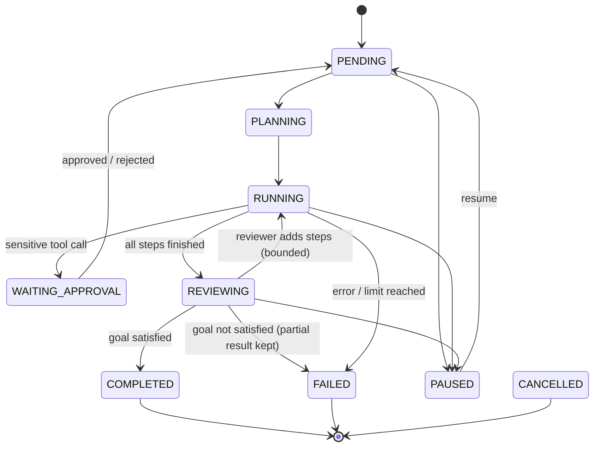

# Dot Lab architecture

This document describes how Dot Lab is built today and how it maps to the
long-term design (orchestrator, planner, executor, reviewer, tools, memory).
It is updated at the end of every milestone.

## Components

| Concept | Module | Responsibility |
|---|---|---|
| Orchestrator | `app/agent/agent.py` (`Agent`) | Drives one task through its lifecycle; all state is stored in SQLite so a task can resume after an approval, pause or restart. |
| Planner | `app/agent/planner.py` | Turns a goal into a structured plan (OpenAI Structured Outputs) and validates every step against the tool registry. |
| Executor | `app/agent/executor.py` | Generates tool arguments, validates them against the tool's Pydantic input model, runs the tool with a timeout and bounded retries, and runs reasoning steps. |
| Reviewer | `app/agent/evaluator.py` (`Evaluator`) | Judges each step (continue / retry / finish / fail) and reviews the whole result at the end. |
| LLM provider | `app/agent/llm.py` | `LLMClient` protocol, `OpenAILLM` implementation, model availability check. Other providers implement the same protocol. |
| Tool registry | `app/tools/` | `BaseTool` interface and the registered tools. The agent can only call tools in the registry. |
| Approvals | `app/approvals/manager.py` | Human-in-the-loop approval requests and decisions. |
| Long-term memory | `app/memory/` | `MemoryStore` interface and `SQLiteMemoryStore` (keyword search). |
| Execution log | `app/services/task_service.py` | Tasks, plan, events and tool calls (the audit trail). |
| Runner / monitors | `app/services/runner.py`, `monitoring.py` | Background execution, restart recovery, scheduled goals. |
| API / dashboard | `app/api/`, `dashboard/` | FastAPI routes and the web interface. |

The folder names differ from the original target layout (`app/core/…`).
They were kept on purpose: renaming would touch every import and test without
adding functionality.

## Task lifecycle

Pause and cancel are allowed from every non-final state. Transitions are
enforced in `app/agent/state.py`; anything not listed there is rejected.

**A task is COMPLETED only when the reviewer confirms the goal is satisfied.**
If it is not, the task is FAILED and the partial output is kept in `result`
with a "Partial result" note.

## Memory vs execution log

Two separate stores, with different purposes:

| | Execution log | Long-term memory |
|---|---|---|
| Tables | `tasks`, `task_events`, `tool_calls`, `approvals` | `memories` |
| Contains | Goal, plan, every event, every tool input and output | Reviewer observations and final results of completed tasks |
| Purpose | Audit trail and dashboard history | Context for planning future tasks |
| Written | Automatically, always | Only for useful knowledge |

Raw tool output, goals and plans are **not** copied into long-term memory.
Rows of kind `goal`, `plan` and `tool_result` written by earlier versions stay
in the database untouched; the planner never searches those kinds.

## Safety limits

`MAX_AGENT_ITERATIONS`, `MAX_PLAN_STEPS`, `MAX_STEP_RETRIES`, `MAX_REPLANS`,
`TOOL_TIMEOUT_SECONDS`, `TASK_TIMEOUT_SECONDS` and `MAX_CONCURRENT_TASKS` are
set in `.env`. Token and cost budgets are planned for Milestone 2.

## Startup checks

On startup Dot Lab checks in the background that `OPENAI_MODEL` is available
to the configured API key (short timeout, no retries). The result is shown in
`GET /api/health` as `model_check`:

| status | Meaning |
|---|---|
| `available` | The model exists and the key can use it. |
| `unavailable` | Wrong model name, no access, or the key was rejected. |
| `error` | The check could not reach OpenAI (network). Tasks may still work. |
| `unchecked` | OpenAI is not configured, or the check has not run yet. |
